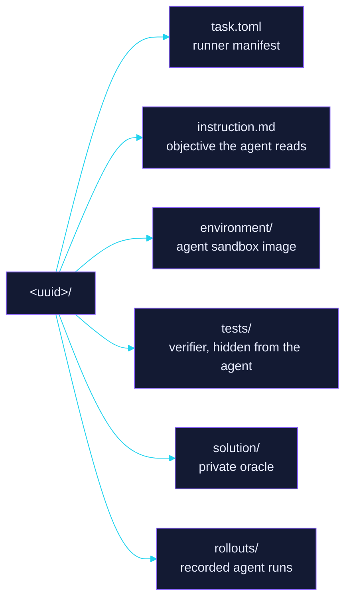

<p align="center"></p>

# Mephisto: samples

<p align="center"><b>The samples lane: 5 Harbor task bundles.</b></p>

<p align="center"><a href="#summary"></a> <a href="#summary"></a> <a href="#about"></a></p>

<p align="center"><sub><a href="#abstract">Abstract</a> | <a href="#summary">Summary</a> | <a href="#coverage">Coverage</a> | <a href="#dataset-structure">Dataset structure</a> | <a href="#verification-and-quality-assurance">Verification and quality assurance</a> | <a href="#about">About</a> | <a href="#cite">Cite</a> | <a href="#license">License</a> | <a href="#contact">Contact</a></sub></p>

## Abstract

The curated lane of this corpus: five Harbor task bundles, each a complete, self-contained task with its own verifier and one recorded agent run.

Each bundle is one Harbor task in a directory named by its content-derived uuid5, so the name doubles as an integrity check. This page is rendered from the resident bundles; a value a bundle does not carry reads `absent`, and the page never fills one in.

All five are professional-knowledge-work tasks drawn from finance back-office and middle-office review desks. Each asks the agent to reproduce a desk's periodic record across six independently fitted lanes, with every lane floored by a competent one-shot method so that only exceeding that floor earns reward. Reward is bounded continuous on 0 to 1, scored per lane and aggregated as a weighted mean.

## Summary

| Property | Value |
| --- | --- |
| Bundles | 5 |
| Harbor schema | 1.4 (5) |
| Reward type | bounded_continuous (5) |
| Agent timeout | 12 h (5) |
| Recorded rollouts | opus-5-5 (5) |

## Coverage

| Keyword | Bundles |
| --- | --- |
| finance | 5 |
| method-imitation | 5 |
| professional-knowledge-work | 5 |
| synthetic | 5 |
| portfolio-surveillance | 2 |
| dealer-lending | 1 |
| document-examination | 1 |
| documentary-credit | 1 |
| floorplan-finance | 1 |
| fund-administration | 1 |
| intercompany-settlement | 1 |
| inventory-finance | 1 |
| letter-of-credit | 1 |
| nav-oversight | 1 |
| receivables-finance | 1 |
| supply-chain-finance | 1 |
| trade-finance | 1 |
| transfer-pricing | 1 |

## Dataset structure

| Bundle | Task | Objective | Keywords |
| --- | --- | --- | --- |
| [`04fb6ba7-d838-59da-b07d-6b683edd47a1`](04fb6ba7-d838-59da-b07d-6b683edd47a1/) | `receivables_finance_surveillance` | Receivables finance portfolio surveillance | finance, method-imitation, portfolio-surveillance, professional-knowledge-work, receivables-finance, supply-chain-finance, synthetic |
| [`0e08e615-419f-5444-b3d7-5357f7c59733`](0e08e615-419f-5444-b3d7-5357f7c59733/) | `transfer_pricing_intercompany_settlement` | Transfer pricing intercompany settlement | finance, intercompany-settlement, method-imitation, professional-knowledge-work, synthetic, transfer-pricing |
| [`19dc92c2-7f44-5ee4-b4c6-5a09e38758e0`](19dc92c2-7f44-5ee4-b4c6-5a09e38758e0/) | `fund_administration_nav_oversight` | Fund administration NAV oversight | finance, fund-administration, method-imitation, nav-oversight, professional-knowledge-work, synthetic |
| [`2f2bb3bd-1f76-53b4-b9ab-3a11acfc300b`](2f2bb3bd-1f76-53b4-b9ab-3a11acfc300b/) | `trade_finance_documentary_credit_examination` | Trade finance documentary credit examination | document-examination, documentary-credit, finance, letter-of-credit, method-imitation, professional-knowledge-work, synthetic, trade-finance |
| [`fc330da8-c1f7-53fc-8c50-b5da77e9b985`](fc330da8-c1f7-53fc-8c50-b5da77e9b985/) | `floorplan_finance_surveillance` | Dealer floorplan finance portfolio surveillance | dealer-lending, finance, floorplan-finance, inventory-finance, method-imitation, portfolio-surveillance, professional-knowledge-work, synthetic |

Every bundle carries the same layout:



## Verification and quality assurance

The verifier travels with the bundle and never reaches the agent. `tests/hidden/truth.jsonl` holds 560 held-out rows in every bundle, `tests/scoring/` carries `eval.py`, `score.py` and a `scorer_manifest.json` naming the scored lanes, and `tests/reward.toml` declares a single weighted-mean reward over them.

Scoring is per lane rather than all-or-nothing, and every bundle uses the same six-lane shape: one profile, one flag, one tier, one cross-sectional rank, and two value lanes such as a reserve, magnitude or count.

| Bundle | Scored lanes |
| --- | --- |
| [`04fb6ba7`](04fb6ba7-d838-59da-b07d-6b683edd47a1/) | dilution_reserve, collection_profile, dispute_flag, recovery_tier, availability_rank, loss_reserve |
| [`0e08e615`](0e08e615-419f-5444-b3d7-5357f7c59733/) | adjustment_magnitude, allocation_key_profile, challenge_flag, method_tier, review_rank, uncertain_tax_reserve |
| [`19dc92c2`](19dc92c2-7f44-5ee4-b4c6-5a09e38758e0/) | nav_break_magnitude, fee_accrual_profile, restatement_flag, pricing_source_tier, oversight_rank, expense_reserve |
| [`2f2bb3bd`](2f2bb3bd-1f76-53b4-b9ab-3a11acfc300b/) | discrepancy_count, discrepancy_class_profile, refusal_flag, tenor_tier, examiner_priority_rank, charge_reserve |
| [`fc330da8`](fc330da8-c1f7-53fc-8c50-b5da77e9b985/) | aging_reserve, turn_profile, sot_flag, variance_tier, headroom_rank, loss_reserve |

Each lane carries a measured competence floor. `solution/measure_floors.py` fits a competent one-shot method per lane and records the result in `solution/floors.json`, and every manifest sets `null_floor = 0.0`, so a submission earns credit only where it beats that method rather than for merely emitting well-formed output.

The scorer is exercised against more than one implementation shape. `solution/checks/test_scorer.py` carries the scorer self-tests, and `solution/alternates/` holds rewrites of the same method: a class facade in all five bundles, split modules in four, and a renamed single module in three. A scorer that silently depended on the reference file layout would not survive them.

Data provenance is declared in `task.toml`: all five set `origin = "original"` and `source_kind = "synthetic"`, and name the deterministic generator and its inputs under `[upstream_provenance]`.

## About

Each bundle directory is a complete Harbor task: `task.toml` is the runner manifest, `instruction.md` the objective, `environment/` the sandbox image, and `tests/` the verifier.

Every bundle also carries `rollouts/<model>/`, holding the prompt, transcript, per-round submissions and final result of one recorded run against that bundle. All five resident rollouts are `opus-5-5` runs that reached the 12 hour agent timeout without a passing round, scoring 0.4578 to 0.6588 on the bounded continuous reward, so they record difficulty evidence rather than reference solutions.

| Bundle | Rounds | Best round | Best score |
| --- | --- | --- | --- |
| [`04fb6ba7`](04fb6ba7-d838-59da-b07d-6b683edd47a1/rollouts/opus-5-5/) | 782 | agent-634 | 0.4578 |
| [`0e08e615`](0e08e615-419f-5444-b3d7-5357f7c59733/rollouts/opus-5-5/) | 420 | agent-273 | 0.6588 |
| [`19dc92c2`](19dc92c2-7f44-5ee4-b4c6-5a09e38758e0/rollouts/opus-5-5/) | 980 | agent-835 | 0.5022 |
| [`2f2bb3bd`](2f2bb3bd-1f76-53b4-b9ab-3a11acfc300b/rollouts/opus-5-5/) | 935 | agent-753 | 0.5608 |
| [`fc330da8`](fc330da8-c1f7-53fc-8c50-b5da77e9b985/rollouts/opus-5-5/) | 785 | agent-757 | 0.4753 |

## Cite

```bibtex
@misc{mephistosamples,
  title = {Mephisto: samples}
}
```

## License

Released under the [MIT License](LICENSE). © 2026 Ethara.AI.

Copyright (c) 2026 Green Rider Technology LLP (Ethara AI). All rights reserved.

## Contact

[Ethara AI on GitHub](https://github.com/Ethara-Ai), [SECURITY.md](SECURITY.md) for a private report, and [CONTRIBUTING.md](CONTRIBUTING.md) for the contribution route.

Copyright (c) 2026 Green Rider Technology LLP (Ethara AI). All rights reserved.
